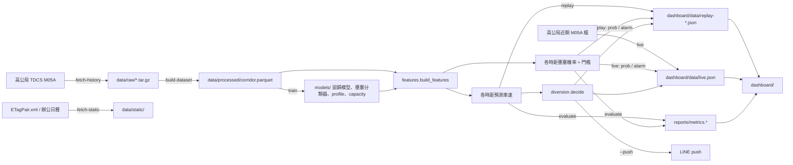

# 01 系統總覽

對應原始碼：`src/fcf/corridor.py`、`src/fcf/cli.py`、各模組（見下方模組地圖）

## 要解決的問題

- **個人最佳 vs 系統最佳**：導航類 App 對每個用戶各自推薦最快路線，若所有人同時改道，替代道路會被灌爆（二次壅塞）。本系統用「配額」限制改道比例（`PENETRATION = 0.30`、以 BPR 估計替代道路增加的旅行時間），挑出對整體車輛總時間最有利的比例 `p*`，詳見 [05-diversion.md](05-diversion.md)。
- **壅塞前預測**：預測 15／30／60 分鐘後各路段車速，在壅塞形成之前就判斷是否值得推播，詳見 [03-features-and-models.md](03-features-and-models.md)、[04-evaluation.md](04-evaluation.md)。

## 走廊

定義在 `corridor.py`，ID 與距離取自高公局 `ETagPair.xml`。方向為北上，湖口 → 高公局。

| 路線 | `route` | 路段數 | 總長 | 入口路段（`ENTRY_SEGMENT`） |
|---|---|---|---|---|
| 國1平面 | `ground` | 14 | 41.0 km | `01F0750N-01F0699N` |
| 五楊高架 | `elevated` | 4 | 41.0 km | `01F0750N-01H0608N` |

- `SEGMENTS` 為全部 18 段（平面 14 段在前，高架 4 段在後），`order` 為該路線內的順序（從 1 起算）。`SEG_IDS`、`SEG_INDEX`、`SEG_BY_ID` 由它衍生，其他模組不得另存路段清單。
- `neighbors(seg_id)` 回傳同一路線上的 (上游, 下游) 路段 ID，路線頭尾為 `None`。上、下游車速是模型特徵（見 03）。
- 入口路段的流量用於分流配額（見 05）。

## 整體資料流

## 模組地圖

| 模組 | 職責 | 詳見 |
|---|---|---|
| `http.py` | 對 tisvcloud 的唯一出口：SSL 修正、41 秒節流 | 02 |
| `tdcs.py` | M05A 解析、歷史檔下載 | 02 |
| `dataset.py` | 原始檔 → 完整 288×18 網格 parquet | 02 |
| `calendar.py` | 辦公日曆與 `is_holiday` | 02 |
| `static.py` | 下載路段幾何與日曆 | 02 |
| `corridor.py` | 路段定義 | 本文件 |
| `features.py` | 特徵、profile、目標值、TRAIN／TEST 常數 | 03 |
| `model.py` | 迴歸與分類器的訓練、載入、預測 | 03 |
| `evaluate.py` | 評估與 `metrics.*` | 04 |
| `diversion.py` | 旅行時間、BPR、配額、推播判斷 | 05 |
| `replay.py` | frame 產生、重播輸出、事件日挑選 | 06 |
| `live.py` | 即時輪詢 | 06 |
| `notify.py` | LINE 推播 | 06 |
| `cli.py` | 命令列入口（`fcf`） | 本文件 |
| `dashboard/` | 靜態儀表板 | 07 |

## CLI 子指令

入口為 `uv run fcf <子指令>`（`cli.py`）。所有路徑相對 repo root。

| 子指令 | 參數 | 輸入 | 輸出 |
|---|---|---|---|
| `fetch-static` | – | tisvcloud `ETagPair.xml`、DGPA 辦公日曆 | `data/static/corridor_geometry.json`、`data/static/calendar_2026.csv` |
| `fetch-history` | `--start`、`--end`（必填）、`--min-interval`（預設 41） | tisvcloud 歷史整日檔 | `data/raw/M05A_YYYYMMDD.tar.gz` |
| `build-dataset` | – | `data/raw/M05A_*.tar.gz` | `data/processed/corridor.parquet` |
| `train` | – | `corridor.parquet`（TRAIN 區間） | `models/h{15,30,60}.joblib`（迴歸）、`models/c{15,30,60}.joblib`（壅塞機率分類器＋門檻）、`profile.parquet`、`capacity.json` |
| `evaluate` | – | `corridor.parquet`、`models/` | `reports/metrics.{json,md}`、`dashboard/data/metrics.json` |
| `find-events` | `--top`（預設 5） | `corridor.parquet`（TEST 區間） | 只印出事件日表格 |
| `replay` | `--date`（必填）、`--start`（06:00）、`--end`（10:00） | `corridor.parquet`、`models/` | `dashboard/data/replay-YYYYMMDD.json`、更新 `index.json` |
| `notify-test` | – | 環境變數 `LINE_CHANNEL_ACCESS_TOKEN`、`LINE_USER_ID` | 送出範例訊息；缺環境變數則 dry-run 印出 |
| `live` | `--push`、`--poll`（預設 120 秒） | tisvcloud 近期 M05A 檔、`models/` | `dashboard/data/live.json` |

`data/raw/`、`data/processed/`、`models/`、`dashboard/data/live.json` 被 `.gitignore` 排除，不進版控。
