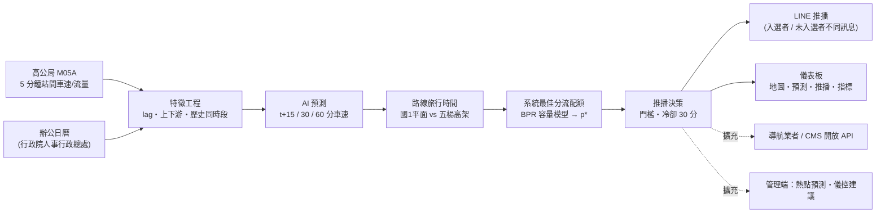

# 國道壅塞預測與系統最佳分流：提案

> 資料來源：交通部高速公路局「交通資料庫」（https://tisvcloud.freeway.gov.tw/）。
> 本文數字皆由本專案程式實際產出：`reports/metrics.md`（評估）、`dashboard/data/replay-*.json`（重播）。可用 `uv run fcf ...` 重現（見 README）。

## 1. 問題與現況

商用導航（Google Maps、Waze）對每位用戶各自計算「個人最快路線」。壅塞發生時，大量用戶同時被導向同一條替代道路，替代道路隨即回堵，原本預期的時間節省消失，甚至把問題轉嫁到市區道路。這是「個人最佳」與「系統最佳」之間的落差。

另外，導航多半在壅塞**已經形成**後才反應；國道用路人真正需要的是在壅塞形成**之前**得知，並在交流道前還來得及改變路線。

本案以國 1 北上 **湖口 → 高公局** 走廊為試驗場域。此走廊有天然的兩條平行路線：

| 路線 | 路段數 | 長度 |
|---|---|---|
| 國1平面 | 14 | 41.0 km |
| 五楊高架 | 4 | 41.0 km |

測試期間的早尖峰（06:00–10:00），國 1 平面多次出現比五楊高架多 5 分鐘以上的預測旅行時間差（見 6.4、6.5），適合驗證「分流」概念。

## 2. 解決方案總覽

流程：每 5 分鐘取得最新車速 → 預測 30 分鐘後兩條路線的旅行時間 → 若平面比高架多出 5 分鐘以上，計算「最多讓多少比例的訂閱用戶改道」才不會讓替代路線回堵（配額 $p^*$）→ 以 `sha256(user_id|date)` 決定哪些用戶入選 → 入選者收到改道建議，未入選者被告知維持原路線。

## 3. 創新亮點

1. **壅塞前預測**：預測 15／30／60 分鐘後各路段車速，而非回報當下路況。
2. **系統最佳分流配額**：與「個人最快路線」不同，以 BPR 容量模型（$t = t_0\,[1 + 0.15\,(v/C)^4]$）掃描改道比例 $p \in \{0, 0.05, \dots, 0.30\}$，選使系統總車輛時間 $v_s'T_s + v_f'T_f$ 最小的 $p^*$。分流比例由配額決定，並以雜湊分組確定性地分配（同一用戶同一天固定落在同一組，兼顧公平且可重現）。
3. **公部門資料融合**：以公部門開放資料（高公局交通資料庫、人事行政總處辦公日曆）為基礎；其餘公部門資料（CCTV、事件、氣象）列為擴充。
4. **管理端閉環**：同一套預測與配額邏輯可輸出給管理端（熱點預測、儀控建議），形成「預測 → 分流 → 成效回饋」閉環（擴充階段）。

## 4. 資料來源

| 資料 | 內容 | 狀態 |
|---|---|---|
| 高公局 M05A | 站間中位數車速與流量（5 分鐘，分車種） | **MVP 已使用** |
| 行政院人事行政總處辦公日曆 | 2026 年上班／放假日 | **MVP 已使用** |
| 高公局 ETagPair（路段幾何） | 路段座標，供地圖繪製 | **MVP 已使用**（靜態資料） |
| 高公局 M03A | 各偵測站車種通行量 | 擴充階段 |
| 高公局 M04A | 站間旅行時間 | 擴充階段 |
| 車輛偵測器（VD） | 即時車速、流量、佔有率 | 擴充階段 |
| CCTV | 影像辨識（車流、事故） | 擴充階段 |
| 1968 事件資料 | 事故、施工、封閉 | 擴充階段 |
| CMS（資訊可變標誌） | 管理端資訊發布介面 | 擴充階段 |
| 氣象署開放資料 API | 降雨、能見度 | 擴充階段 |

> 授權：高公局交通資料庫免費、不限目的；對外提供須標示「交通部高速公路局「交通資料庫」」，重複擷取間隔須大於 40 秒（本專案實作 41 秒節流）。
> 事故、天氣資料目前僅有即時 XML，沒有可回測的歷史資料，故 MVP 不納入，也無法在本案驗證其效益。

## 5. AI 模型與評估方法

- **模型**：每個預測時距（15／30／60 分鐘）一個全域 `HistGradientBoostingRegressor`（scikit-learn），18 個路段共用，路段索引為類別特徵。
- **壅塞機率分類器**：每個時距另有一個同特徵、同參數的 `HistGradientBoostingClassifier`，標籤為 t+h 車速 < 40。機率門檻以 2026-07（訓練期內）當下車速 ≥ 40 的點最大化 F1 選定，再以整個訓練期重新訓練；用於壅塞前預警與儀表板預警卡。
- **特徵**：路段索引、一天中的第幾個 5 分鐘、星期、是否假日、近 6 個時間點車速（lag0–lag5）、近 15 分鐘車速變化、近 3 個時間點流量、上下游路段車速（lag0、lag1）、同路段同時段歷史平均車速（僅用訓練期計算）。
- **資料切分**：訓練 2026-04-01 ～ 2026-07-31；測試 2026-08-01 ～ 2026-09-06（皆含頭尾）。測試期間不參與任何參數、歷史平均或容量的計算。
- **基準線**：持續法（t+h 車速 = 現在車速）、歷史平均（同路段同時段同日型）。
- **指標**：
  - 車速誤差：MAE、RMSE（km/h），分「全部」與 `am_peak`（上班日 06:00–10:00）。
  - 壅塞前預警：只取當下車速 ≥ 40 km/h 的點；實際 t+h < 40 為正例，預測為正的定義：回歸模型預測車速 < 40、分類器壅塞機率 ≥ 門檻；Precision、Recall、F1。
  - 壅塞起點提前量：某路段車速由「連續 ≥3 步 ≥40」轉為 <40 的第一個時間點為 onset；在其前 60～5 分鐘內，找最早的、當下車速仍 ≥40 且存在某時距 h 使 t+h 落在 onset ±10 分鐘且該方法對 t+h 發出預警（回歸模型預測 <40，或分類器機率 ≥ 門檻）的 t；提前量 = onset − t。
  - 壅塞定義：車速 < 40 km/h（參考高公局壅塞等級定義）。
- **旅行時間估計**：$\sum$ 路段長度 / max(車速, 5) × 3600，以同一時刻車速估整條路線，不做時變行進模擬。

## 6. 實證結果

以下數字**逐字取自 `reports/metrics.md`**。

### 6.1 車速誤差（km/h，MAE／RMSE）

| 時距 | 子集 | 樣本數 | 模型 MAE | 持續法 MAE | 歷史平均 MAE | 模型 RMSE | 持續法 RMSE | 歷史平均 RMSE |
|---|---|---|---|---|---|---|---|---|
| 15 分 | all | 191705 | 2.82 | 3.57 | 4.94 | 4.82 | 6.20 | 9.40 |
| 15 分 | am_peak | 21600 | 3.84 | 5.25 | 7.81 | 6.39 | 8.71 | 12.44 |
| 30 分 | all | 191645 | 3.42 | 4.60 | 5.30 | 6.29 | 8.62 | 9.86 |
| 30 分 | am_peak | 21600 | 5.24 | 7.98 | 9.40 | 8.91 | 13.24 | 14.34 |
| 60 分 | all | 191527 | 3.95 | 6.16 | 6.18 | 7.50 | 11.77 | 11.28 |
| 60 分 | am_peak | 21600 | 6.53 | 11.26 | 11.69 | 10.98 | 18.58 | 17.96 |

早尖峰 30 分鐘時距 MAE 5.24 km/h（持續法 7.98）、60 分鐘 6.53 km/h（持續法 11.26）。

### 6.2 壅塞前預警（當下車速 ≥ 40，預測 t+h 是否 < 40）

- 分類器門檻於 2026-07-01 ～ 2026-07-31 最大化 F1 選定；15 分 0.20、30 分 0.20、60 分 0.25

| 時距 | 子集 | 方法 | Precision | Recall | F1 | 實際壅塞數 |
|---|---|---|---|---|---|---|
| 15 分 | all | 回歸模型 | 73.1% | 25.2% | 37.5% | 948 |
| 15 分 | all | 分類器 | 43.9% | 55.8% | 49.2% | 948 |
| 15 分 | all | 歷史平均 | 40.2% | 3.7% | 6.8% | 948 |
| 15 分 | am_peak | 回歸模型 | 77.8% | 38.9% | 51.9% | 352 |
| 15 分 | am_peak | 分類器 | 55.4% | 62.5% | 58.7% | 352 |
| 15 分 | am_peak | 歷史平均 | 40.2% | 9.9% | 15.9% | 352 |
| 30 分 | all | 回歸模型 | 80.9% | 19.5% | 31.4% | 1544 |
| 30 分 | all | 分類器 | 46.3% | 53.4% | 49.6% | 1544 |
| 30 分 | all | 歷史平均 | 32.2% | 1.8% | 3.4% | 1544 |
| 30 分 | am_peak | 回歸模型 | 81.8% | 31.3% | 45.3% | 617 |
| 30 分 | am_peak | 分類器 | 54.8% | 63.9% | 59.0% | 617 |
| 30 分 | am_peak | 歷史平均 | 32.2% | 4.5% | 8.0% | 617 |
| 60 分 | all | 回歸模型 | 80.2% | 17.1% | 28.2% | 2378 |
| 60 分 | all | 分類器 | 52.3% | 46.7% | 49.3% | 2378 |
| 60 分 | all | 歷史平均 | 19.5% | 0.7% | 1.4% | 2378 |
| 60 分 | am_peak | 回歸模型 | 83.0% | 28.0% | 41.9% | 961 |
| 60 分 | am_peak | 分類器 | 58.7% | 61.2% | 59.9% | 961 |
| 60 分 | am_peak | 歷史平均 | 19.5% | 1.8% | 3.2% | 961 |

回歸模型的預警 Precision 高（約 73–83%）、Recall 低（約 17–39%）：發出預警時多半是對的，但漏掉大部分壅塞。分類器以較低的機率門檻換取 Recall：早尖峰 30 分鐘時距 Recall 由 31.3% 提高到 63.9%、F1 由 45.3% 提高到 59.0%，Precision 由 81.8% 降到 54.8%。全部時段（all）30 分鐘 Recall 由 19.5% 提高到 53.4%、F1 由 31.4% 提高到 49.6%。分類器僅用於預警，分流決策仍使用回歸模型的 30 分鐘預測車速。

### 6.3 壅塞起點提前量

| 方法 | 起點事件數 | 提前偵測數 | 偵測率 | 提前量中位數（分） |
|---|---|---|---|---|
| 回歸模型 | 353 | 167 | 47.3% | 10.0 |
| 分類器 | 353 | 305 | 86.4% | 30.0 |

偵測率只計「有沒有提早命中」，不懲罰誤報；分類器的警報較寬鬆，解讀時須與 6.2 的 Precision 一併看。

### 6.4 分流模擬（TEST 期間上班日 06:00–10:00，含 30 分鐘冷卻）

| 項目 | 數值 |
|---|---|
| 模擬步數（5 分鐘） | 1200 |
| 推播事件數 | 151 |
| 平均預估節省（個人最快路線 naive，未考慮回堵，分鐘） | 10.2 |
| 平均預估節省（配額分流，分鐘） | 9.3 |
| 替代路線 TT 增加（全部訂閱用戶改道 naive，分鐘） | 1.03 |
| 替代路線 TT 增加（配額，分鐘） | 0.74 |
| 平均 p*（可改道比例上限為 0.30） | 0.264 |
| 配額實際生效（p* < 0.30）的推播數 | 41 |
| 上班日數 | 25 |
| 系統車輛時間節省：配額分流（車輛小時，估算） | 2024 |
| 系統車輛時間節省：全部訂閱用戶改道 naive（車輛小時，估算） | 1774 |

決策原因分布：below_saving=394、cooldown=633、missing_volume=1、no_benefit=21、ok=151

### 6.5 重播案例：2026-09-03（測試期間事件排名第 1）

當日 09:50 國 1 平面與五楊高架實際旅行時間差達 31.5 分鐘，國 1 平面 06:00–10:00 有 145 個「路段×5 分鐘」車速 < 40 km/h。系統當日共推播 8 次（皆在冷卻期之外）。08:20 的推播：

> 【國道壅塞預警】預測 08:50 起國1平面「林口(文化北路)-林口(文化一路)」時速將降至 22 km/h。建議改走五楊高架，預估可省 22 分鐘。為避免替代道路回堵，本次僅建議 100% 訂閱用路人改道。資料來源：交通部高速公路局「交通資料庫」

此時配額無需限縮（$p^* = 0.30$，即 100% 訂閱用戶皆可改道），替代路線旅行時間在 naive 與配額情境相同（1735 秒）。

另一個配額生效的案例（2026-09-02 09:20，$p^* = 0.10$，建議 33% 訂閱用戶改道）：

> 入選者：【國道壅塞預警】預測 09:50 起國1平面「桃園(49A)-林口(文化北路)」時速將降至 33 km/h。建議改走五楊高架，預估可省 12 分鐘。為避免替代道路回堵，本次僅建議 33% 訂閱用路人改道。資料來源：交通部高速公路局「交通資料庫」
>
> 未入選者：【國道壅塞預警】國1平面預計延誤 13 分鐘，替代道路已分流其他用路人，建議您維持原路線以免回堵。資料來源：交通部高速公路局「交通資料庫」

此時若 30% 用戶全數改道，替代路線預測旅行時間由 1639 秒增至 1763 秒（約 +2.1 分鐘）；配額限縮後為 1675 秒（約 +0.6 分鐘）。儀表板截圖：[`docs/dashboard-replay-20260902.png`](dashboard-replay-20260902.png)。

## 7. 推播與介接

- **LINE**：已實作。`fcf notify-test`／`fcf live --push` 透過 LINE Messaging API push 推播；未設定 token 時為 dry-run。
- **推播內容**：入選者收到改道建議（含預測時間、最差路段、預估節省、改道比例）；未入選者被告知預計延誤並建議維持原路線。訊息一律附資料來源標示。
- **導航業者與 CMS**：以開放 API 介接規劃（輸出「路線、時段、建議改道比例」，由導航業者在路線推薦時套用配額；CMS 顯示建議）。MVP 未實作，不在本次驗證範圍。

## 8. 管理端應用

同一預測結果可提供：

- **熱點預測**：未來 30–60 分鐘可能壅塞的路段排行，供巡邏、事故應變預先布署。
- **號誌與匝道儀控建議**：預測壅塞路段上游匝道的放行速率建議；配額 $p^*$ 亦可作為替代道路容量的警示。

以上為擴充方向，MVP 僅輸出預測，未與管理系統整合。

## 9. 效益

以分流模擬（25 個上班日、早尖峰 06:00–10:00、每次推播涵蓋其後 30 分鐘）估算，系統車輛時間節省：

- 配額分流：**2024 車輛小時**（約 81 車輛小時／上班日）。
- 全部訂閱用戶改道（naive）：**1774 車輛小時**（約 71 車輛小時／上班日）。

配額分流較 naive 多節省約 14%，且替代路線旅行時間增加較小（0.74 vs 1.03 分鐘）。

估算假設：僅計小客車；以走廊入口 5 分鐘流量代表該 30 分鐘；訂閱用戶佔車流 30%；旅行時間隨流量變化採 BPR 函數，容量取訓練期入口流量 95 百分位。這是**模型估算**，並非實際用戶行為觀測。

碳排：運輸研究的碳排放係數多以「每公里」或「每公噸公里」表示，無法由「車輛小時」直接換算；本案未找到可引用的官方「每車輛小時」係數，故不提供碳排數字，僅定性說明：縮短壅塞停等時間可降低怠速與走停油耗。

## 10. 推動時程

| 階段 | 內容 |
|---|---|
| 已完成（MVP） | 單一走廊、M05A、車速預測、系統最佳分流、LINE 推播、重播與即時儀表板 |
| 短期 | 接入 CCTV 影像辨識（事故、車流），補強 recall |
| 中期 | 氣象與事件特徵；歷史事件資料累積後回測效益 |
| 長期 | 擴充市區道路、多走廊；導航業者與 CMS API 介接；真實用戶 A/B 驗證 |

## 11. 限制與隱私

**限制**

- 評估僅涵蓋單一走廊、37 天測試期間（含假日）；分流模擬僅涵蓋 25 個上班日早尖峰。
- 壅塞起點偵測率：回歸模型 47.3%、中位數提前量 10 分鐘；分類器 86.4%、中位數 30 分鐘，但代價是預警 Precision 降至約 44–59%（見 6.2、6.3），即每次警報約有四到五成為誤報。分類器的機率門檻只在訓練期內的驗證月（2026-07）決定，未用測試期調整。
- 重播以資料時間戳為「現在」，未模擬高公局檔案發布延遲（實測約 5–7 分鐘），實際可用提前量會相應縮短。
- 分流效益由 BPR 模型與固定訂閱比例（30%）估算，用戶是否遵從建議、替代路線實際回堵情形均未實測。
- 旅行時間以同一時刻車速估算，未考慮車速隨行進時間變化。
- 事故、天氣、施工未納入模型。

**隱私**

- 本案不蒐集個人行車軌跡。輸入資料為 eTag 門架的去識別化統計（站間中位數車速、流量）。
- 推播僅需用戶的 LINE userId；改道分組以 `user_id|日期` 雜湊決定，不需位置資訊。
